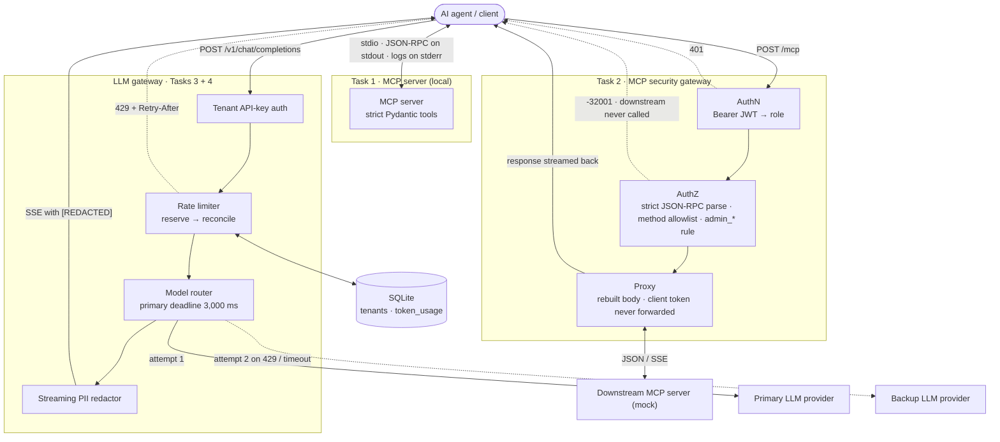

# AI infrastructure: MCP server, MCP security gateway and LLM gateways

Four independent services built for an AI Field Developer / Solutions Engineer technical assessment. The
brief itself is not included in this repository. Each task has its own subpackage and test folder, and runs on
its own. The subpackages never import each other.

| Task | Package | What it does | Status |
|---|---|---|---|
| 1 | `ai_gateway.mcp_server` | MCP server over stdio with strict input validation | Done |
| 2 | `ai_gateway.mcp_gateway` | MCP security gateway: bearer-token roles, tool-level authorization | Done |
| 3 | `ai_gateway.llm_gateway` | Streaming LLM gateway with real-time PII redaction | In progress: redactor and upstream client done |
| 4 | `ai_gateway.model_router` | Token-aware rate limiter on SQLite with primary-to-backup failover | Done |

## Architecture

How the pieces fit together. In this repo, Tasks 3 and 4 run as separate services. Combining them into a single
streaming pipeline would only allow failover before the first token reaches the client.



## Quick start

Requires [uv](https://docs.astral.sh/uv/). Python 3.12 is pinned in `.python-version`, and uv installs it if it is missing.

```bash
uv sync                              # create .venv and install locked dependencies
uv run pytest -q                     # every test
uv run pytest tests/mcp_server -q    # one task at a time
uv run pytest -m "not e2e and not slow" -q   # skip subprocess, real-server and timing tests
uv run ruff check                    # lint
```

## Task 1: MCP server with strict validation

### Run it

```bash
uv run t1-mcp-server                 # or: uv run python -m ai_gateway.mcp_server
```

The server speaks MCP over stdin and stdout, so it is normally started by an MCP host. To try it from a shell:

```bash
printf '%s\n' \
  '{"jsonrpc":"2.0","id":0,"method":"initialize","params":{"protocolVersion":"2025-11-25","capabilities":{},"clientInfo":{"name":"cli","version":"0"}}}' \
  '{"jsonrpc":"2.0","method":"notifications/initialized"}' \
  '{"jsonrpc":"2.0","id":1,"method":"tools/call","params":{"name":"get_customer_record","arguments":{"customer_id":"CUST-00042"}}}' \
  | uv run t1-mcp-server 2>/dev/null
```

- With MCP Inspector: `npx @modelcontextprotocol/inspector uv --directory "$PWD" run t1-mcp-server`.
- In an MCP host such as Claude Desktop:
  `{"mcpServers": {"customer-records": {"command": "uv", "args": ["--directory", "/absolute/path/to/repo", "run", "t1-mcp-server"]}}}`.
- Logs go to stderr. Set `MCP_SERVER_LOG_LEVEL=DEBUG` for more detail.

Demo customers: `CUST-00042`, `CUST-01815`, `CUST-12345`. The data is fictional and kept in memory.

### Tools

- **`get_customer_record`**: returns the customer's profile as structured content.
- **`trigger_refund`**: records a refund and returns a receipt.

Both tools publish their input and output JSON Schemas and behavior hints (read-only or not) in
`tools/list`. The input schema is generated from the same Pydantic model that validates each call, so
what clients see is exactly what the server enforces.

### Validation rules

| Argument | Rule | Rejected examples |
|---|---|---|
| `customer_id` | `^CUST-[0-9]{5}$` | `CUST-1234`, `cust-12345`, `" CUST-12345"`, `"CUST-12345\n"`, `CUST-１２３４５` (fullwidth digits), `12345` |
| `amount` | number, greater than 0, finite; JSON integers accepted | `0`, `-0.0`, `-1`, `NaN`, `Infinity`, `1e309`, `"10.5"`, `true`, `null` |
| `reason` | string of 10 to 1,000 characters, no leading or trailing whitespace | `"012345678"`, `"          "`, `" refund requested"`, `1234567890` |
| any other key | not allowed (`additionalProperties: false`) | `{"approved_by": "me"}` |

### Error mapping

| Situation | Response |
|---|---|
| Arguments fail validation (format, type, missing or unknown key) | JSON-RPC error `-32602 Invalid params` with `data: {tool, errors: [{field, message, type}]}` |
| Unknown tool | JSON-RPC error `-32602 Unknown tool: <name>` |
| Valid arguments, but no such customer | Tool result with `isError: true` (a business outcome, not a protocol error) |
| Any unexpected exception | JSON-RPC error `-32603 Internal error`; the details go to the server log only |

Example: `trigger_refund` called with `{"customer_id": "CUST-00042", "amount": -5, "reason": "duplicate charge"}`
returns

```json
{"jsonrpc": "2.0", "id": 7, "error": {"code": -32602, "message": "Invalid params", "data": {"tool": "trigger_refund",
 "errors": [{"field": "amount", "message": "Input should be greater than 0", "type": "greater_than"}]}}}
```

Error details never echo submitted values. The names of unexpected keys are shown only when they look like
ordinary identifiers. Unexpected exceptions are wrapped explicitly: without that, the SDK would answer stdio
clients with `{"code": 0, "message": "<exception text>"}`, which leaks internals. A test reproduces that leak.

### The stdio transport

The SDK's `stdio_server()` keeps the protocol on a private copy of stdout and points fd 1 at stderr while
serving. Its stdin handling is too lenient, though, so `stdio_transport.py` reads stdin itself:

| Input line | Reply |
|---|---|
| Blank | Ignored |
| Not JSON, not UTF-8, `NaN`/`Infinity` literal, duplicate keys | `-32700 Parse error`, `"id": null` |
| Batch array; `id` that is `null`, a boolean or a float; missing `"jsonrpc": "2.0"`; line over 1 MiB | `-32600 Invalid Request`, with the `id` echoed when it is valid |
| A request whose `params` is not an object | `-32602 Invalid params` |
| `tools/call` before `initialize` | `-32602` (from the SDK) |
| Unknown method | `-32601 Method not found` (from the SDK) |

What the transport adds:

- **End-of-input drain.** When stdin closes, pending requests get up to 1.5 seconds to finish before the
  server shuts down, so a host that pipes requests and closes stdin gets every reply.
- **Stray-output guard.** While serving, `sys.stdout` is redirected to stderr, and the original stream is
  flushed before fd 1 is restored. Buffered stray output therefore cannot reach the protocol stream at exit.

Measured against the SDK's plain `stdio_server()`, same server, same piped input (20 tool calls, then two
malformed lines; the end-to-end tests cover each behavior):

| | Tool replies | Errors for malformed lines | Stray text on stdout |
|---|---|---|---|
| Plain `stdio_server()` | 11 to 12 of 20 | 0 of 2 (the client waits forever) | Yes |
| This transport | 20 of 20 | 2 of 2 | No |

## Task 2: MCP security gateway

An HTTP reverse proxy in front of an MCP server. It reads the bearer token, extracts the caller's role, and inspects
every JSON-RPC message before deciding whether to forward it.

### Run it

```bash
cp .env.example .env                       # then set GATEWAY_JWT_SECRET, for example to $(openssl rand -hex 32)
uv run t2-mock-downstream                  # demo MCP server (official SDK) on 127.0.0.1:8001
uv run --env-file .env t2-gateway          # the gateway on 127.0.0.1:8000
VIEWER=$(uv run --env-file .env t2-mint-jwt --role viewer --subject alice)
ADMIN=$(uv run --env-file .env t2-mint-jwt --role admin --subject root)

mcp() { curl -s http://127.0.0.1:8000/mcp -H "authorization: Bearer $1" \
  -H 'content-type: application/json' -H 'accept: application/json, text/event-stream' -d "$2"; }
mcp "$VIEWER" '{"jsonrpc":"2.0","id":1,"method":"tools/list"}'
mcp "$VIEWER" '{"jsonrpc":"2.0","id":2,"method":"tools/call","params":{"name":"admin_reset_key","arguments":{"key_id":"k-1"}}}'
mcp "$ADMIN"  '{"jsonrpc":"2.0","id":3,"method":"tools/call","params":{"name":"admin_reset_key","arguments":{"key_id":"k-1"}}}'
```

The viewer's admin call is answered by the gateway and never reaches the downstream server:

```json
{"jsonrpc":"2.0","id":2,"error":{"code":-32001,"message":"Unauthorized Tool Call",
 "data":{"reason":"forbidden_tool","tool":"admin_reset_key","required_role":"admin"}}}
```

The official MCP client works unchanged; the token goes on its HTTP client:

```python
async with httpx2.AsyncClient(headers={"authorization": f"Bearer {token}"}) as http:
    async with Client(streamable_http_client("http://127.0.0.1:8000/mcp", http_client=http)) as client:
        await client.call_tool("admin_reset_key", {"key_id": "k-1"})  # MCPError -32001 for a viewer
```

The demo downstream is a stateless MCP server with the tools `echo`, `get_status`, `slow_echo`, `admin_reset_key` and
`admin_delete_user`. Pass `--sse` to make it answer with event streams.

### How a request is handled

| Step | Rejected with |
|---|---|
| 1. An `Origin` header, if present, must be allow-listed (DNS-rebinding protection) | 403 |
| 2. `Authorization: Bearer <JWT>`: HS256 only; `exp`, `iat`, `sub`, `aud` and `role` required | 401 with a `WWW-Authenticate` challenge |
| 3. `Content-Type: application/json`, body at most 1 MiB | 415 / 413 |
| 4. Strict JSON-RPC parsing: exactly one request or notification | `-32700` / `-32600` (HTTP 400) |
| 5. 2026-07-28 clients: the `Mcp-Method` and `Mcp-Name` headers must match the body | `-32020` (HTTP 400) |
| 6. Policy: method allowlist and the `admin_` rule | `-32601`, `-32602` or `-32001` |
| 7. Forward: the message is rebuilt from the parsed fields, and the reply streams back as it arrives | 502 / 504 if the downstream fails |

Every decision is written to an audit log (subject, role, method, tool, decision). Tokens are never logged.

### Authorization rules

- `tools/list` is forwarded unfiltered for any authenticated role, as the brief requires.
- A `tools/call` for a tool whose name starts with `admin_` needs the `admin` role. Otherwise the gateway answers
  `-32001 Unauthorized Tool Call` itself. The prefix is compared case-insensitively, so `ADMIN_reset_key` fails closed.
- Tool names must use MCP tool-name characters (`[A-Za-z0-9_.-]`, up to 128). That rules out whitespace and Unicode
  look-alikes such as a fullwidth `ａｄｍｉｎ_`.
- Only `initialize`, `ping`, `server/discover`, `tools/list`, `tools/call` and the lifecycle notifications pass.
  Anything else is `-32601`. A `tools/call` sent without an `id` (which would run with no reply) is rejected.

### Hardening against bypasses

| Attack | Defense |
|---|---|
| Duplicate keys: `{"name": "get_status", "name": "admin_reset_key"}` | Rejected (`-32700`): JSON parsers disagree on which value wins |
| A batch with an admin call inside | Rejected (`-32600`): MCP no longer supports batching |
| A "response" that also has a method: `{"result": {}, "method": "tools/call", ...}` | Rejected (`-32600`): the SDK downstream ignores the extra keys and would run it as a request |
| Headers naming one tool while the body names another (2026-07-28) | Rejected (`-32020`), using the SDK's own checks |
| Reusing the client's token against the downstream | The `Authorization` header is never forwarded (MCP forbids token passthrough) |
| Bytes that differ from what was checked | The forwarded body is rebuilt from the parsed message |

### Tested end to end

`tests/mcp_gateway/test_e2e.py` starts the real gateway and the SDK downstream as processes, and drives them with
the official MCP client over TCP, in both protocol eras (2025-11-25 and 2026-07-28) and both downstream modes (JSON
and SSE). It covers:

- unfiltered tool listing;
- `-32001` for viewers, with the downstream's own call log confirming nothing arrived;
- admin calls;
- 401 for missing or invalid tokens;
- a tool that runs longer than 5 seconds;
- a client hang-up that cancels the downstream tool.

## Task 3: Streaming LLM gateway with real-time PII redaction

In progress. Done so far: the streaming redactor (`ai_gateway.llm_gateway.redaction`), and reading the upstream
stream (`sse`, `events` and `upstream`). The gateway endpoint and the mock provider come next.

### What is redacted

| Kind | Shape | Example |
|---|---|---|
| Email | ASCII `local@domain.tld`; local part 1 to 64 characters, TLD 2 to 24 letters | `john.doe@example.com` |
| SSN | `ddd-dd-dddd` or `ddd dd dddd` (one separator style), and nine bare digits that can be an SSN (area not 000 or 666, group not 00, serial not 0000) | `123-45-6789`, `123456789` |
| Card | 13 to 19 digits, optionally with single spaces or hyphens between them | `4111 1111 1111 1111` |

Detection is by shape, because redacting too much is the safe direction. So `1234 5678 9012 3456` is redacted even
though it fails the Luhn check, and so is the SSA example number `987-65-4321`. Two options trade recall for
precision. `card_luhn` redacts only numbers that start with 2 to 6 and pass the Luhn check. `bare_ssn=False` leaves
bare nine-digit numbers alone.

### Redacting a stream without buffering it

PII can be split across deltas: `"Mail john.do"`, then `"e@example.com now"`. Releasing each delta as it arrives
would leak `john.do`, and buffering the whole response would defeat streaming. The redactor holds back only the
end of the text that could still become part of a match:

- Each pattern family has a closed alphabet and a maximum length. Emails use letters, digits and `._%+-@`, and are
  at most 342 characters long. SSNs and cards use digits, spaces and hyphens, and are at most 37 characters long.
- A match that later text could still change must lie in the trailing run of its family's alphabet, within its
  maximum length of the end. Everything before that point is final, so it is redacted and released at once.
- Matching is tried only where a match can start: at a digit not preceded by a digit, or at most 64 characters
  before an `@`. Each position is examined once.

For the example above, the client receives `"Mail "`, then `"[REDACTED] "`. The word `now` follows with the next
delta or at the end of the stream, because it could still be the start of an email address. Ordinary prose is
released about one token late for the same reason.

### Guarantees, and how they are tested

- **The way the text is split does not matter.** For any text split into any deltas, the streamed output equals
  redacting the whole text at once, and nothing released is ever taken back. Hypothesis checks this on random texts
  and random splits, and a unit test splits each kind of PII at every offset.
- **The rules are exactly the documented ones.** Batch output matches an independent reference implementation,
  and, without Luhn, a plain `re.sub` with the same pattern.
- **Bounded memory.** At most 342 characters are held back, whatever the size of the deltas.
- **Fast on adversarial input.** 1 MB fed in 1 to 4 character deltas takes 0.4 to 1 s for digits, email-like
  text, card-like text, JWT-like text and prose (`uv run pytest -m slow`).
- **The holdback's assumptions hold.** A test walks the parsed patterns. Every character they can consume belongs
  to their family's alphabet, every lookbehind is one character wide, and every match length is bounded.

### Known limits

- Non-ASCII, quoted and IP-literal email addresses are not detected. A local part over 64 characters leaves its
  first characters visible.
- Next to other digit groups, shapes cannot tell where a number ends. An extra group can stay visible
  (`ref 1234 4111 1111 1111 1111` becomes `ref [REDACTED] 1111`), and a card-shaped run can absorb the first digits
  of an adjacent SSN, leaving its last four visible.
- At the normal end of a stream, an unfinished fragment is released as it is, since `john.doe@exa` is not an email
  address. When a stream is cut off by an error, the held-back text is dropped instead.

### Reading the upstream stream

The gateway reads the provider's Server-Sent Events with its own decoder (`sse.py`). httpx2's built-in `EventSource`
drops comments, replaces invalid UTF-8, decodes with whatever charset the server declares, and checks its size limit
only after buffering a chunk. Its `aiter_lines()` also splits on U+2028 and U+0085. The decoder follows the WHATWG
rules with stricter input handling:

- lines end at CR, LF or CRLF only, including a CRLF split across network chunks;
- every line is strict UTF-8, and invalid bytes are an error;
- a line or an event over 1 MiB is an error, refused before it is buffered;
- comments are kept, as proof that the provider is alive;
- an event cut off by the end of the stream is discarded, as the spec and the OpenAI SDK do.

Upstream chunks are never forwarded. The gateway rebuilds every chunk it sends from normalized events (`events.py`),
so only text it understands reaches the client, and all of that text goes through the redactor:

| In the upstream delta | What happens |
|---|---|
| `content` (a string, or Mistral's list of text parts) and `refusal` | Relayed, redacted, each with its own redactor |
| `reasoning`, `reasoning_content` and similar | Dropped |
| `tool_calls`, `function_call`, `audio`, `images` | Refused: the request cannot ask for them, and they could not be redacted as text |
| `role`, `annotations`, `citations` and other known metadata | Ignored |
| Any other field with a value | Refused, since it could be a text channel the gateway does not know |

An error object (top-level `error`, `object: "error"`, Groq's `x_groq.error`), an `event: error`, or an error finish
reason (`error`, `abort`, ...) means the generation failed. Finish reasons map onto OpenAI's `stop`, `length` and
`content_filter`. A stream succeeds only once a finish reason has arrived: `[DONE]` alone does not prove it, and a
truncated stream fails closed. The normalizer is tested against 55 provider-shaped streams, each with its source:
OpenAI, Azure OpenAI, vLLM, llama.cpp, Ollama, LiteLLM, OpenRouter, Groq, DeepSeek, Mistral, Together, Fireworks,
Gemini, TGI, SGLang, plus shapes that must fail closed.

### Upstream failures

`open_stream` returns only once the first event has arrived and been checked, so until then the client still gets a
proper HTTP error. No upstream body is ever passed on, since it can echo the prompt. The `x-should-retry` header tells
the OpenAI SDKs whether retrying can help; otherwise they retry 408, 409, 429 and 5xx:

| Upstream | Client | Code | Retry |
|---|---|---|---|
| 429 | 429 with `Retry-After` | `upstream_rate_limited` | yes |
| 503, 529 | 503 with `Retry-After` | `upstream_overloaded` | yes |
| 408, 504, or any timeout | 504 | `upstream_timeout` | yes |
| 400, 404, 413, 422 | 400 | `upstream_rejected_request` | no |
| 401, 403 (the gateway's own key) | 502 | `upstream_auth_failed` | no |
| Other 5xx, 409, connection failures | 502 | `upstream_unavailable` | yes |
| Not a 200 event stream; invalid or unexpected data | 502 | `upstream_protocol_error` | no |
| An error reported in the stream | 502 | `upstream_error` | no |
| Connection pool exhausted | 503 | `gateway_overloaded` | yes |

The client connects with explicit timeouts: 5 s to connect, at most 120 s of silence between bytes, and 60 s from
the request to the first event. It ignores proxy settings from the environment, never follows redirects (that would
send the API key elsewhere), and asks for an uncompressed stream. Real-socket tests cover a refused connection, a
server that never answers, silence mid-stream, truncated chunked and unframed bodies, a connection reset, and a full
connection pool.

## Task 4: Token-aware rate limiter with model failover

A non-streaming, OpenAI-compatible `POST /v1/chat/completions`. Each tenant has a budget of tokens per minute,
enforced over a sliding 60-second window kept in SQLite on disk. Requests go to a primary provider, and fail over
to a secondary when the primary answers 429 or has not delivered its whole response within 3,000 ms.

### Run it

```bash
uv run t4-tenants add acme --tokens-per-minute 3000     # prints acme's API key, once
uv run t4-mock-provider --port 9201 --name primary --mode rate_limited --control
uv run t4-mock-provider --port 9202 --name secondary
uv run t4-router                                        # 127.0.0.1:8300, tenants and usage in t4-router.db

curl -si http://127.0.0.1:8300/v1/chat/completions -H "authorization: Bearer $KEY" \
  -H 'content-type: application/json' \
  -d '{"model": "gpt-test", "messages": [{"role": "user", "content": "Hello"}]}'
```

From a real run: the primary answers 429, so the secondary serves the request.

```
HTTP/1.1 200 OK
x-gateway-provider: secondary
x-ratelimit-limit-tokens: 3000
x-ratelimit-remaining-tokens: 2987
x-request-id: req_1de96f40363846ffaea4c2525c02b874
{"id":"chatcmpl-secondary-...","object":"chat.completion","created":1793930134,"model":"gpt-test",
 "choices":[{"index":0,"message":{"role":"assistant","content":"[secondary] Hello"},"finish_reason":"stop"}],
 "usage":{"prompt_tokens":9,"completion_tokens":4,"total_tokens":13}}
```

Then, with the primary answering after 2 s (`curl -X PUT http://127.0.0.1:9201/_mode -d '{"mode": "slow",
"delay": 2}'`), four concurrent requests with `"max_tokens": 1000` hold reservations at the same time. Two fit in
the 3,000-token budget and two get `429` with `Retry-After: 60`. A request that could never fit is refused at once:

```json
{"error":{"type":"invalid_request_error","code":"request_too_large","message":"The request may use up to 4039 tokens, more than the tenant limit of 3000 tokens per minute. Send a shorter prompt or a lower max_tokens.","request_id":"req_ac11319b4a6847daa08df0a66e610f13"}}
```

The mock provider's other modes are `ok`, `slow_drip` (headers at once, the body slowly), `error`, `malformed` and
`no_usage`. The router is configured with `T4_*` variables (see `.env.example`). The main ones are `T4_DB_PATH`, and
`T4_PRIMARY_URL`, `T4_PRIMARY_API_KEY` and `T4_PRIMARY_DEADLINE_MS` (3000) with their `T4_SECONDARY_*` equivalents
(15000 ms for the deadline). `T4_DEFAULT_MAX_TOKENS` (1024) and `T4_MAX_OUTPUT_TOKENS` (4096) bound the completion
cap.

### How a request is handled

| Step | Rejected with |
|---|---|
| 1. `Authorization: Bearer <tenant key>`, looked up by its SHA-256 digest, before the body is read | 401 with a `WWW-Authenticate` challenge |
| 2. `Content-Type: application/json`, body at most 1 MiB | 415 / 413 |
| 3. Strict JSON (no duplicate keys, no `NaN`) and a strict request model: text messages only, no tools, no streaming, `n` = 1, at most one of `max_tokens` and `max_completion_tokens` (default 1024, at most 4096) | 400, naming the fields but never echoing input |
| 4. The cost estimate (prompt estimate plus the completion cap) must fit the tenant's whole budget | 400 `request_too_large` |
| 5. Atomic admission in the tenant's 60-second window | 429 with `Retry-After` and `X-RateLimit-*` |
| 6. The providers in order, each within its total deadline | see the failover table |
| 7. Settlement: the reservation is replaced by what the request really cost | never changes the response |

The completion cap is always sent to the provider, so the reservation is a real upper bound. The prompt estimate
errs high: three ASCII characters per token, one token per other character, over the exact JSON sent, plus a fixed
overhead per message.

### The token window

- **Storage.** One SQLite connection per process, used only from one worker thread, in FIFO order. No query blocks
  the event loop. WAL journaling is checked at startup, and the router refuses to start without it. Every write
  starts with `BEGIN IMMEDIATE`, which serializes threads and processes alike.
- **Admission is one transaction.** Rows dated in the future (the clock stepped back) are moved to now, rows older
  than 60 s are deleted, the rest are summed, and the request is either reserved in full or denied. A row exactly
  60 seconds old no longer counts.
- **`Retry-After` is exact.** It is the whole seconds until enough of the oldest rows have left the window, so it is
  both sufficient (retrying then succeeds, without new traffic) and tight (a second earlier fails).
- **Fails closed.** If SQLite errors, or stays locked for more than 2 s, the answer is 503 `limiter_unavailable` and
  nothing is sent to a provider.
- **Charging.** A request is settled exactly once:
  - an attempt that never reached its provider, or got 429, costs nothing;
  - an attempt that timed out, failed with a 5xx or broke after sending costs its prompt estimate, so provoking
    timeouts does not buy free tokens;
  - the successful attempt costs the provider's own usage, or the whole reservation when usage is missing or not
    believable.
- **Cancellation and restarts.** If the client goes away while the admission is queued, it is withdrawn, or released
  right after it runs, so no reservation is left behind. The window survives a restart, because it is on disk.

### Failover

Each attempt has a total deadline covering connecting, the headers and the whole body: 3,000 ms for the primary,
15,000 ms for the secondary. httpx2's per-read timeout is off, so a provider that drips its body slowly cannot keep
resetting it. Vendor-side retries are off. The client sees the outcome of the last attempt:

| Last attempt | Status | Code | Fails over |
|---|---|---|---|
| Timed out | 504 | `upstream_timeout` | yes |
| 429 | 503 | `upstream_unavailable` (429 is kept for the tenant's own limit) | yes |
| 5xx, connection failure, broken or invalid response | 502 | `upstream_error` | yes |
| 400, 413, 422 | 400 | `upstream_rejected_request` | no: the next provider would reject it too |
| 401, 403, 404 and other 4xx | 502 | `upstream_configuration_error` | no |

A successful response is rebuilt as a plain `chat.completion`. Upstream bodies, which can echo the prompt, never
reach the client or the logs. Logs record the provider, outcome, status and time of each attempt, and the tokens
charged.

### Errors

Every response carries a server-generated `X-Request-ID`. Every error, including routing errors and unexpected
exceptions, uses one payload, with no stack trace and no upstream body:

```json
{"error": {"type": "rate_limit_error", "code": "tenant_token_limit_exceeded",
           "message": "The tenant limit of 3000 tokens per minute is reached; retry after 60 s.",
           "request_id": "req_..."}}
```

| Status | Type | Codes |
|---|---|---|
| 400 | `invalid_request_error` | `invalid_json`, `invalid_request`, `conflicting_max_tokens`, `max_tokens_too_large`, `request_too_large`, `upstream_rejected_request` |
| 401 | `authentication_error` | `missing_api_key`, `invalid_api_key` |
| 404, 405 | `invalid_request_error` | `not_found`, `method_not_allowed` |
| 413, 415 | `invalid_request_error` | `body_too_large`, `unsupported_media_type` |
| 429 | `rate_limit_error` | `tenant_token_limit_exceeded` |
| 500 | `server_error` | `internal_error` |
| 502 | `upstream_error` | `upstream_error`, `upstream_configuration_error` |
| 503 | `server_error`, `upstream_error` | `limiter_unavailable`, `upstream_unavailable` |
| 504 | `upstream_error` | `upstream_timeout` |

### Tested end to end

- `tests/model_router/test_e2e.py` runs the router and two mock providers as processes, with the tenant created by
  `t4-tenants`. It covers:
  - failover to the secondary when the primary is rate limited, slow, dripping its body, failing or malformed
    (the slow modes give up at the deadline, not after the 3 s the primary would take);
  - a clean 502 when both providers fail;
  - a concurrent burst that gets exactly two 200s and three 429s with `Retry-After`;
  - the window surviving a router restart;
  - unknown keys refused before any provider is called.
- **Contention.** Threads, and separate processes started with `spawn`, race on one database file behind a
  barrier with a shared clock. Exactly `limit // cost` requests are admitted, and no worker sees "database is
  locked".
- **A reference model.** Hypothesis compares the limiter with a brute-force model, including the 59,999 ms and
  60,000 ms boundaries, clock steps and settlements. `Retry-After` matches the model's smallest sufficient wait.
- **Deadlines** (50 ms in the tests): a hang, slow headers, a slow-drip body and an answer right at the deadline.
  Each gives exactly one response and one settlement. So do every failover path, cancellation mid-attempt, and a
  settlement that fails.
- **Sanitization**, with `raise_server_exceptions=False`: upstream bodies holding secrets, an unexpected exception,
  a broken database, validation errors carrying PII in values and field names, and routing errors.

## Requirements versus implementation choices

The assessment leaves some details open. These are the choices made, and why:

- **Invalid tool arguments are JSON-RPC errors (`-32602`), as the brief requires.** Recent MCP spec
  revisions (2025-11-25 onward) suggest reporting input-validation failures as `isError` tool results so
  the model can self-correct. The SDK's high-level `MCPServer` does exactly that, which is why this server
  uses the low-level `Server`. The spec itself is not consistent here: its 2026-07-28 `InvalidParamsError`
  definition still lists invalid tool arguments under `-32602`. Unknown tools are `-32602` in every
  revision.
- **`CUST-XXXXX` means five ASCII digits.** The pattern uses `[0-9]`, not `\d`, because `\d` also matches non-ASCII
  digits such as `١٢٣٤٥`, both in Python's `re` and in pydantic's regex engine.
- **No type coercion.** `"10.5"` and `true` are not accepted as amounts. JSON integers are accepted because JSON has
  a single number type.
- **`reason` may not start or end with whitespace.** This rejects whitespace-only reasons while keeping the rule
  expressible in the published JSON Schema (`minLength` plus `pattern`).
- **`amount` follows the brief literally: positive and finite.** A maximum amount or a two-decimal rule would be
  business rules the brief does not state, so they are not enforced.
- **Gateway tokens are HS256-signed JWTs with a `role` claim.** This is one way to "extract the user's role" from a
  bearer token. `t2-mint-jwt` mints development tokens; in production an identity provider would issue them, and
  OAuth discovery (RFC 9728 protected-resource metadata) is out of scope here.
- **`-32001` is returned with HTTP 200.** The error stays inside the JSON-RPC response, so the official MCP client
  raises `MCPError(-32001)`. An HTTP 403 would make MCP clients start an OAuth step-up flow instead. The code itself
  is what the brief asks for. Note that the 2026-07-28 spec marks `-32000` to `-32019` as a legacy range, and the
  Python SDK uses `-32001` for its own local request timeouts. The stable `data.reason = "forbidden_tool"` tells the
  two apart.
- **Methods other than `tools/list` and `tools/call` go through an allowlist.** The brief only defines those two
  methods. Lifecycle messages are allowed, and everything else is denied (fail closed).
- **Cancellation on client hang-up depends on the downstream.** The gateway always closes its downstream request
  when the client disconnects. An SDK server answering with event streams then cancels the tool. In its JSON-response
  mode, the SDK does not watch for disconnects, so the tool runs to completion.
- **PII is detected by shape, not validated.** The brief names emails, SSNs and credit card numbers without
  defining their formats. Shape matching redacts some numbers that are not real cards or SSNs, which is the safe
  direction for a privacy filter. Luhn validation is available as an option.
- **Only text the gateway understands is relayed.** The brief asks for redaction "in real time" but says nothing
  about channels other than the text. Tool calls, audio and unknown delta fields are refused rather than passed on,
  and reasoning text is dropped, so nothing reaches the client without going through the redactor.
- **A stream must end with a finish reason to count as complete.** Some providers send `[DONE]` after an error or
  a cut-off, so `[DONE]` alone is not trusted.
- **"Times out after 3000ms" is a deadline for the whole response.** Connecting, the headers and the full body must
  all arrive within 3 s, so a provider that answers headers fast and then stalls still fails over. A streaming
  router would apply the deadline to the time to first token instead.
- **Failover also covers connection failures, 5xx and invalid responses.** The brief names 429 and timeouts. Other
  transient failures fail over too, but a provider's 400-class rejection does not, since the secondary would reject
  the same request.
- **"Token-aware" means reserve an upper estimate, then settle.** Tokens are only known after the response, so
  admission reserves the prompt estimate plus the completion cap (which is always sent), and settlement records the
  provider's usage. Reservations never exceed the limit at admission; afterwards, usage can only exceed it by the
  estimation error of requests still in flight.
- **A provider's 429 becomes a 503 for the client.** 429 is kept for the tenant's own limit, so a client can tell
  "you are over your budget" from "the providers are busy".
- **Tenants are API keys in the same SQLite file, stored as SHA-256 digests.** Usage is counted per tenant, not per
  key, so rotating keys does not reset the window. Unknown keys get 401.
- **Timeouts and 5xx after sending are charged the prompt estimate.** Otherwise a client could provoke timeouts to
  get free tokens. Attempts that never reached a provider, or got 429, cost nothing.
- **Invalid requests get 400, not FastAPI's 422.** That is what OpenAI-compatible clients expect.

## Project layout

```
src/ai_gateway/
├── mcp_server/     # Task 1
├── mcp_gateway/    # Task 2
├── llm_gateway/    # Task 3
└── model_router/   # Task 4
tests/
├── mcp_server/     # one folder per task, added as each task is built
├── mcp_gateway/
├── llm_gateway/
└── model_router/
```
